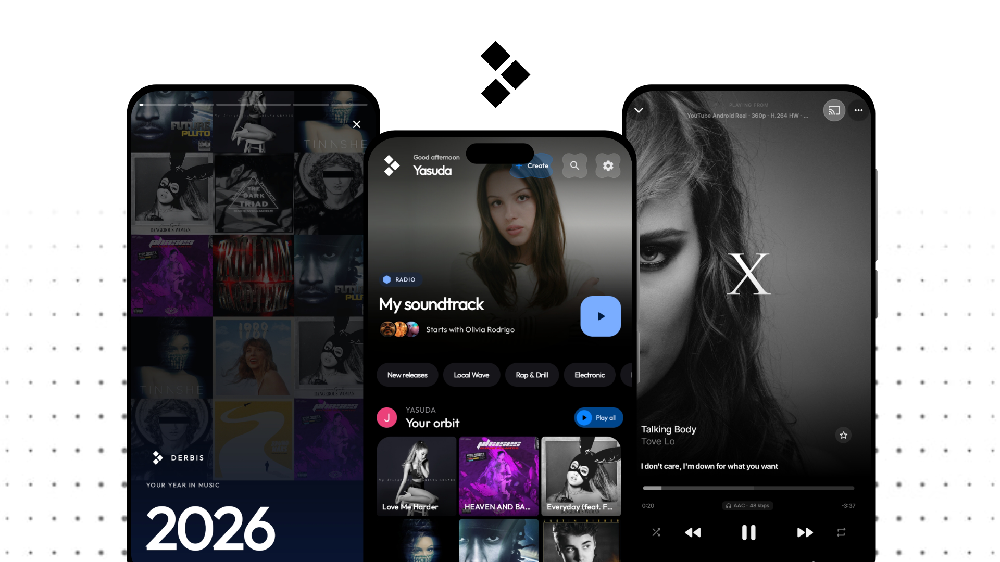
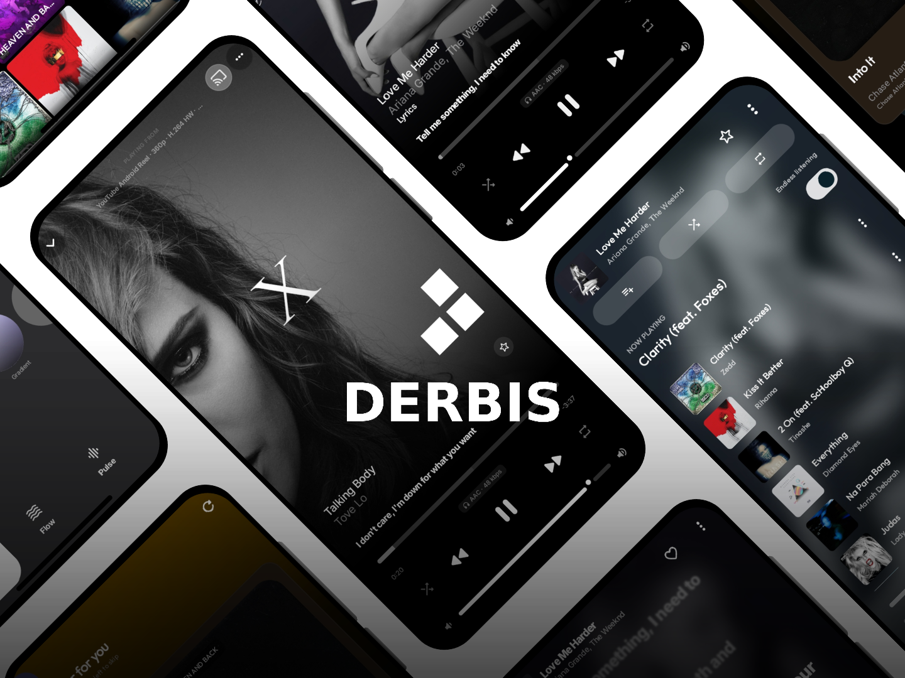
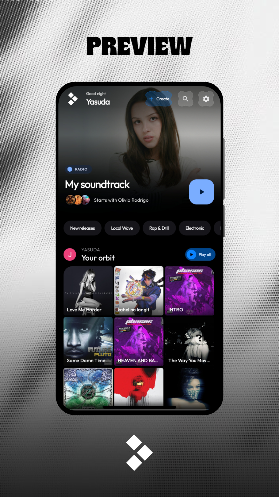
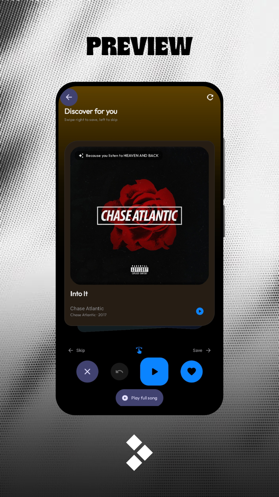
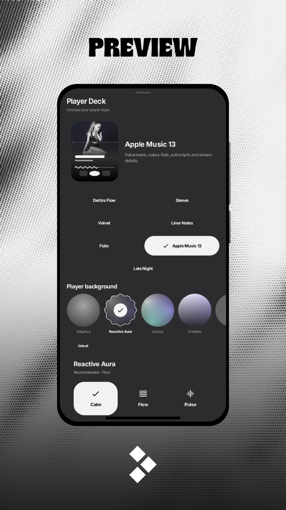
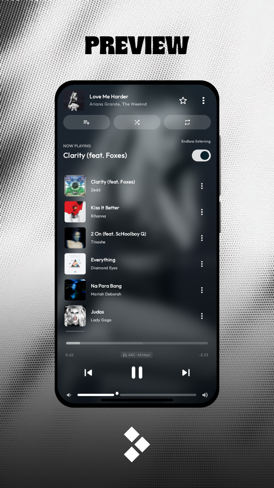
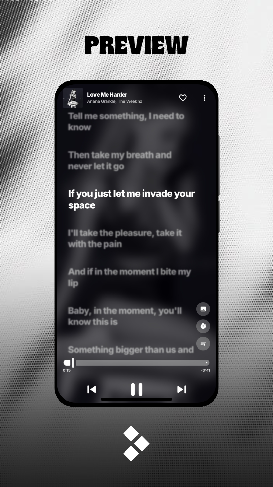
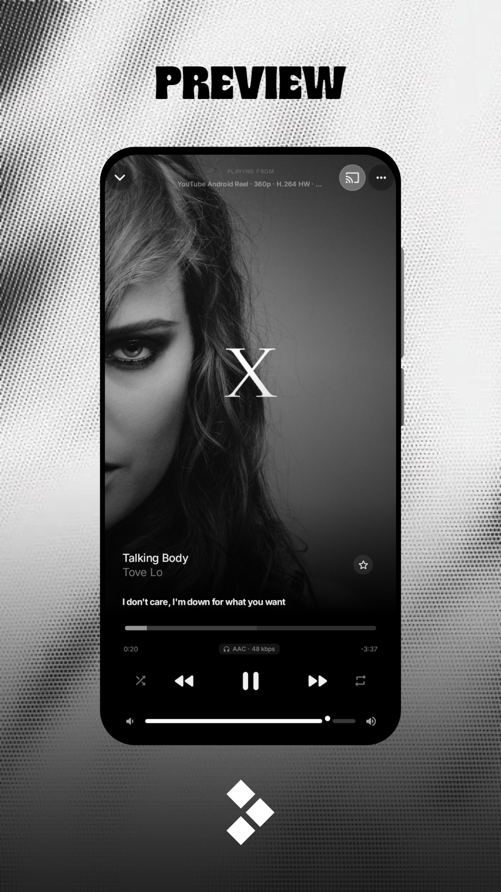
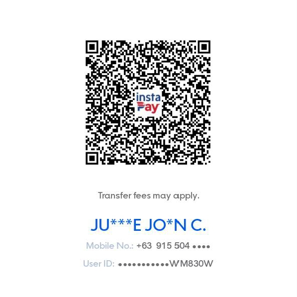

# Derbis

<p align="center">
  
</p>

**Sleek, lightweight, AMOLED-optimized music player for Android and Desktop.**

<p align="center">
  <a href="https://github.com/jusnie/Derbis/releases/latest"></a>
  <a href="LICENSE"></a>
  <a href="https://github.com/jusnie/Derbis"></a>
</p>

<h2 align="center">Screenshots</h2>

<p align="center">
  
</p>

<p align="center">
  
  
</p>

<p align="center">
  
  
</p>

<p align="center">
  
  
</p>

---

## ✨ Features

- 🖤 **Pure AMOLED Black & White Design**: Minimalist pitch-black interface (#000000) with crisp white accents, optimized for OLED displays and battery efficiency.
- ⚡ **Lightweight & High Performance**: Clean R8-optimized release build with zero runtime diagnostic overhead, snappy animations, and 120Hz smooth scrolling.
- 🌅 **Dynamic Greetings**: Welcomes you based on the time of day ("Good morning", "Good afternoon", "Good evening", "Good night") across both Android and Desktop.
- 🎵 **Unified Music Experience**: Stream high-quality tracks and play your local audio library seamlessly.
- 📜 **Synced Lyrics**: Follow along with synchronized timed lyrics and word-by-word playback.
- 🔒 **Privacy Focused**: No accounts, no data collection, no telemetry.
- 📱 **Built for Android**: Native Kotlin app (`com.derbis.app`); the Windows desktop client is retired for now and may return later.

---

## 📥 Downloads and version history

Every release has a version-specific **What's Fixed**, **What's New**, and **Changed** record. Browse the full [GitHub Releases history](https://github.com/jusnie/Derbis/releases) or read the concise [CHANGELOG](CHANGELOG.md).

- **Android (APK):** [Derbis v1.1.0](https://github.com/jusnie/Derbis/releases/tag/v1.1.0)

See the [release process](docs/RELEASE_PROCESS.md) for package naming, test-release, and publication rules.
The Windows desktop client is no longer built from this repository.

---

## 🛠️ Building from Source

### Android Build
```bash
./gradlew :app:assembleRelease
```
The output APK will be located at `app/build/outputs/apk/release/app-release.apk`.

### Website
The dependency-free responsive web companion lives in [`website/`](website/). It uses browser-native HTML5 audio, so it does **not** need VLC or a desktop helper. Its optional Google/YouTube connection is limited to official Google authorization and YouTube Data API access; setup instructions are in [`website/README.md`](website/README.md).

---

<h2 align="center">Support Derbis</h2>

<p align="center">
  If Derbis makes your listening better, you can support its continued development.
</p>

<p align="center">
  <a href="https://buymeacoffee.com/yasudaig"></a>
  <a href="https://www.paypal.me/YasudaPlayz"></a>
</p>

<p align="center">
  
  <br>
  <sub>Scan with GCash or a supported InstaPay app.</sub>
</p>

---

## 📄 License

Derbis is free software under the **GNU General Public License v3.0**. See [LICENSE](LICENSE).  
Copyright © 2026 **Yasuda**.

You may run it, study it, share it and change it. If you distribute a modified build, it has to stay
under the GPL and ship its source. Contributions are welcome — read [CONTRIBUTING.md](CONTRIBUTING.md)
before opening a pull request.
